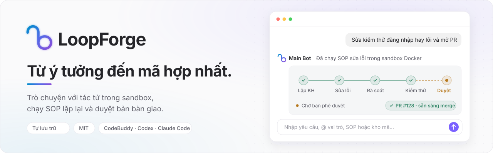
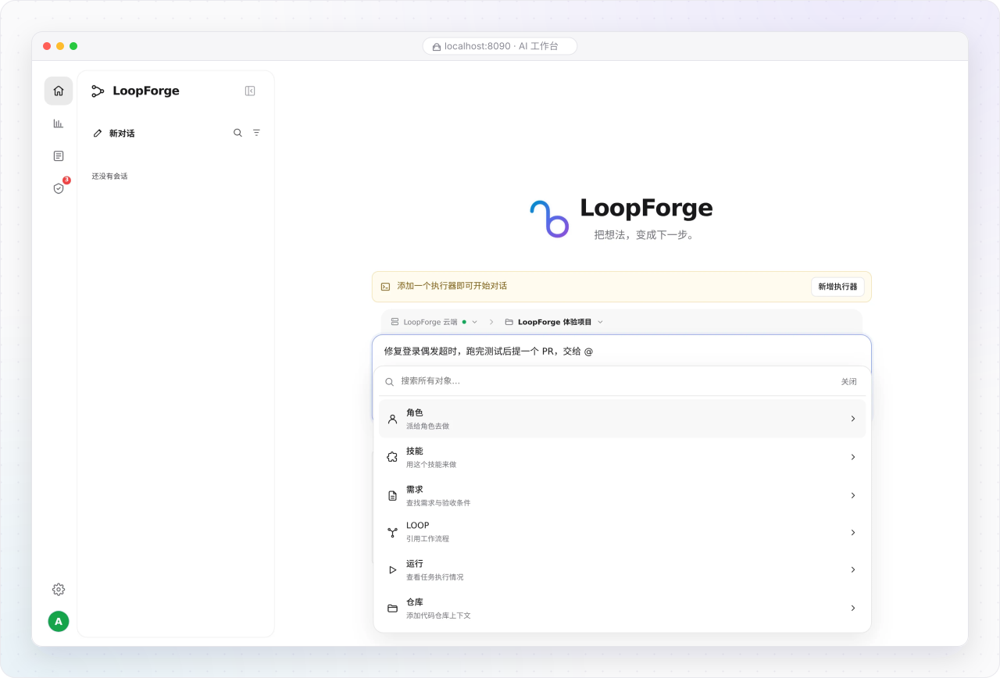
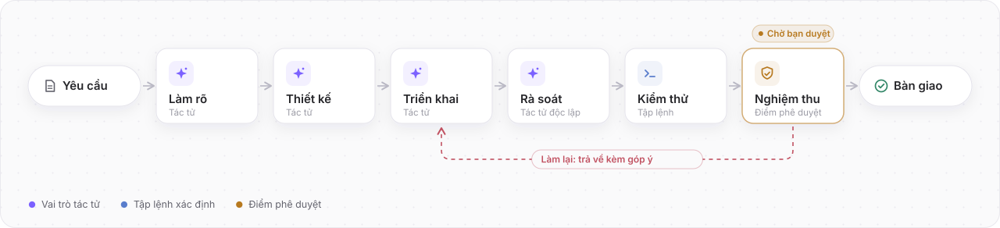
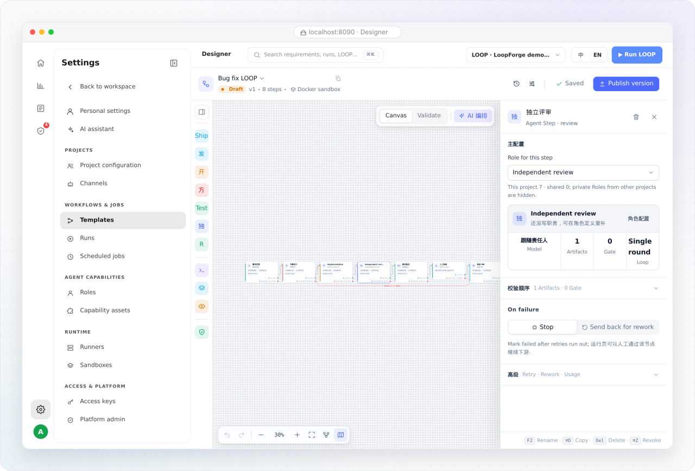
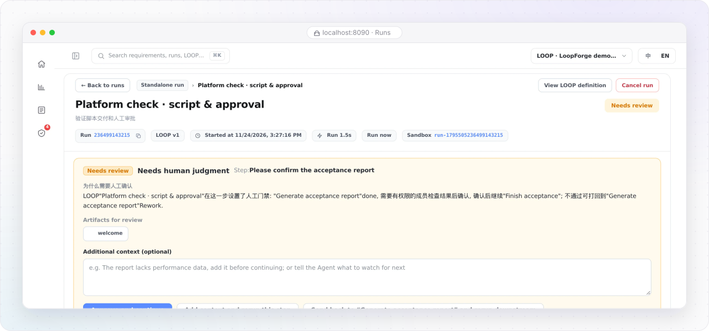
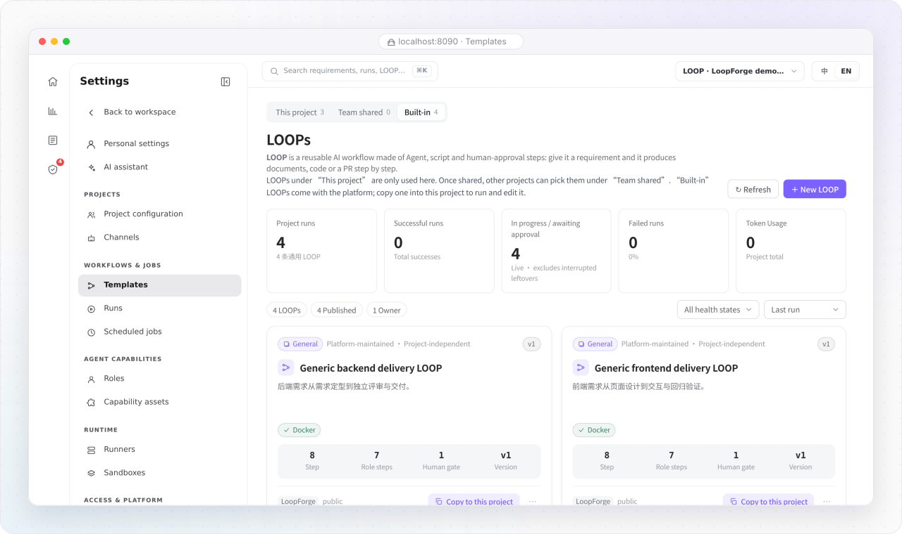

<p align="center">
  <picture>
    <source media="(prefers-color-scheme: dark)" srcset="docs/assets/readme/hero-vi-dark.svg">
    
  </picture>
</p>

<p align="center">
  <a href="https://github.com/Tencent/LoopForge/actions/workflows/platform.yml"></a>
  <a href="LICENSE"></a>
  
  <a href="https://github.com/Tencent/LoopForge/stargazers"></a>
</p>

<p align="center">
  <a href="https://trendshift.io/repositories/300138?utm_source=repository-badge&amp;utm_medium=badge&amp;utm_campaign=badge-repository-300138" target="_blank" rel="noopener noreferrer"></a>
</p>

<p align="center">
  <a href="README.md">English</a> · <a href="README.zh-CN.md">简体中文</a> · <b>Tiếng Việt</b>
</p>

<p align="center">
  <a href="#hai-cách-làm-việc">Hai cách làm việc</a> ·
  <a href="#bắt-đầu-nhanh">Bắt đầu nhanh</a> ·
  <a href="#cách-sop-hoạt-động">SOP</a> ·
  <a href="#tính-năng">Tính năng</a> ·
  <a href="#loopforge-local">Local (phiên bản cũ)</a> ·
  <a href="#câu-hỏi-thường-gặp">FAQ</a> ·
  <a href="#tài-liệu">Tài liệu</a>
</p>

https://github.com/user-attachments/assets/8af401d9-1aae-427c-b4bc-455c12d17beb

<p align="center"><sub>Video giới thiệu sản phẩm dài 80 giây (1080p, có âm thanh).</sub></p>

**LoopForge** là không gian làm việc tự lưu trữ, giúp nhóm của bạn bàn giao phần mềm bằng các tác tử lập trình (coding agent). Hãy mô tả yêu cầu cho **Main Bot** trong cuộc trò chuyện: bot sẽ mở một sandbox Docker, checkout các kho mã của bạn, phân công công việc cho các vai trò trong dự án và mở PR. Khi một cách làm đã chứng minh được hiệu quả, hãy lưu nó dưới dạng **SOP** (quy trình làm việc chuẩn gồm các tác tử, tập lệnh và điểm phê duyệt của con người) để yêu cầu tiếp theo được bàn giao theo cùng một quy trình, có sẵn bước rà soát và phê duyệt.

Các CLI của tác tử lập trình trực tiếp thực hiện công việc: CodeBuddy, Codex, Claude Code, OpenCode, Cursor CLI, Antigravity, Kimi Code, Pi, DeepSeek Harness và ZCode. LoopForge bổ sung các vai trò, sandbox, điểm kiểm soát và lịch sử hoạt động xung quanh chúng, tất cả chạy trên hạ tầng của bạn theo giấy phép MIT.

## Hai cách làm việc

| | **Trò chuyện với Main Bot** | **Chạy SOP** |
| --- | --- | --- |
| Phù hợp nhất với | Khám phá, sửa nhanh, cải tiến qua nhiều lượt với tác tử | Bàn giao có thể lặp lại với các giai đoạn cố định và bước phê duyệt |
| Cách chạy | Main Bot mở [không gian làm việc của cuộc trò chuyện](docs/conversation-workspaces.md) (sandbox Docker chứa các kho mã của bạn) theo nhu cầu và gọi các vai trò dự án dưới dạng tác tử phụ | Bộ máy thực thi chạy các nút Agent, Script, Human gate và SOP con theo thứ tự trong sandbox riêng |
| Cách bạn kiểm soát | Xếp hàng tin nhắn hoặc điều hướng tác tử ngay khi đang trả lời; tạm dừng, tiếp tục hoặc tiếp quản SOP đang chạy từ cuộc trò chuyện | Phê duyệt tại các điểm kiểm soát của con người, trả công việc về bước đã chọn, thử lại hoặc chạy lại từ bất kỳ nút nào |
| Kết quả bàn giao | PR/MR hoặc hợp nhất trực tiếp vào nhánh dùng chung (`mode=direct`) | Tài liệu, mã nguồn hoặc PR cùng với sản phẩm đầu ra và nhật ký của từng nút |

Cả hai cách đều theo dõi cùng một tập **yêu cầu**, để mọi thay đổi, dù thực hiện qua trò chuyện hay SOP, đều liên kết với yêu cầu ban đầu và được tính vào báo cáo bàn giao và chi phí.

<p align="center">
  <picture>
    <source media="(prefers-color-scheme: dark)" srcset="docs/assets/readme/chat-home-dark.svg">
    
  </picture>
</p>

<p align="center"><sub>Trang chủ trò chuyện. Nhập yêu cầu, dùng <code>@</code> để tham chiếu vai trò, kỹ năng, yêu cầu, SOP hoặc kho mã; chọn trình thực thi, mô hình và chế độ quyền cho từng cuộc trò chuyện.</sub></p>

## Vì sao chọn LoopForge

Khi yêu cầu một tác tử lập trình «sửa lỗi này», kết quả phụ thuộc vào từng lượt chạy. Tác tử có thể bỏ qua kế hoạch, quên kiểm thử, tự rà soát mã của mình hoặc dừng giữa chừng mà không ai nhận ra. Điều đó có thể chấp nhận được khi trình diễn, nhưng không phải cách một nhóm bàn giao phần mềm.

- **Có thể lặp lại.** Cùng SOP, cùng các giai đoạn và phép kiểm tra cho mọi yêu cầu. Bắt đầu từ các SOP tích hợp sẵn cho backend, frontend, sửa lỗi và sản phẩm.
- **Phân tách vai trò.** Lập kế hoạch, triển khai, rà soát và kiểm thử đều có prompt, trình thực thi, mô hình, quy tắc, Skills và công cụ MCP riêng. Một vai trò có thể là nút SOP hoặc tác tử phụ trong cuộc trò chuyện.
- **Con người giám sát.** Các tác tử tự chạy trong khi bạn giám sát. Có thể tạm dừng, điều hướng hoặc tiếp quản bất cứ lúc nào. Điểm phê duyệt dừng lượt chạy khi con người phải quyết định: phê duyệt hoặc trả công việc về bước đã chọn.
- **Có thể quan sát và tiếp tục.** Trạng thái nút, dấu vết gọi công cụ, nhật ký và sản phẩm đầu ra ở cùng một nơi. Tạm dừng, thử lại bước thất bại hoặc chạy lại từ bất kỳ nút nào.
- **Công nghệ và máy chủ của bạn.** Mười CLI tác tử lập trình làm trình thực thi, từ CodeBuddy, Codex và Claude Code đến OpenCode, Cursor CLI và các CLI khác. GitHub, Skills và MCP đóng vai trò công cụ. Sandbox Docker hoặc máy của bạn là môi trường thực thi.

## Bắt đầu nhanh

Trước tiên, cài **Git** và sao chép kho mã. Trình cài đặt kiểm tra Docker, Compose, Python 3 và curl, đồng thời đề nghị cài các thành phần còn thiếu. Trên Linux, việc cài Python/curl hỗ trợ apt, dnf và yum; plugin Compose hỗ trợ x86_64/arm64 và xác minh SHA-256 của bản phát hành chính thức. macOS cần Python 3 hoạt động và Docker Desktop; Homebrew có thể cài các thành phần còn thiếu. Người dùng Linux thông thường có thể sử dụng quyền qua nhóm Docker hoặc sudo. Đặt `LOOPFORGE_YES=1` để chấp nhận các lời nhắc cài đặt. Việc tải gói và image Docker cần kết nối Internet.

```bash
git clone https://github.com/Tencent/LoopForge.git
cd LoopForge
./start.sh
```

`./start.sh` tải image phát hành GHCR được cố định phiên bản trong `compose.yaml` mà không build cục bộ (`bash scripts/install.sh` cũng làm tương tự). Script tạo các dịch vụ MySQL và nền tảng, sinh cấu hình và khóa bí mật phiên, cài các sandbox tích hợp, SOP mẫu và dự án chào mừng. Không cần cài Go và Node.js trên máy chủ. Sau khi khởi động, hãy cấu hình API key của mô hình và cấp quyền GitHub. Dùng `./start.sh logs`, `stop`, `restart` hoặc `pull` để quản lý; dùng `./start.sh dev` để build từ mã nguồn đã checkout.

Nếu việc tải từ `ghcr.io` bị đình trệ, `./start.sh` và `./start.sh pull` đo thời gian truy cập `ghcr.io` và so sánh với máy chủ mirror của Đại học Nam Kinh [ghcr.nju.edu.cn](https://doc.nju.edu.cn/books/e1654/page/ghcr). Mirror Nam Kinh chỉ được sử dụng khi digest của manifest trùng với digest vừa đọc từ ghcr.io; script tải image theo digest đó rồi gắn lại tag thành tên đã cố định trong `compose.yaml`. Điều này đồng nghĩa với việc tin cậy máy chủ mirror vì kết quả mang tên chính thức. Nếu thiếu digest chính thức, digest không khớp hoặc tải từ mirror thất bại, script vẫn dùng `ghcr.io`. `MIRROR=ghcr.io` buộc dùng registry gốc; `MIRROR=ghcr.nju.edu.cn` buộc dùng mirror Nam Kinh; lựa chọn không được ghi vào `.env`. GitHub Release ghi lại digest; lệnh `docker image inspect --format '{{index .RepoDigests 0}}' ghcr.io/tencent/loopforge:<pin>` phải hiển thị cùng digest sau ký tự `@`. `compose.yaml` không thay đổi. Mục cấu hình Docker `registry-mirrors` như `https://docker.nju.edu.cn` chỉ tăng tốc Docker Hub và không phải giá trị cho `MIRROR`.

```bash
./start.sh
MIRROR=ghcr.io ./start.sh
MIRROR=ghcr.nju.edu.cn ./start.sh pull
```

Mở địa chỉ do trình cài đặt in ra và tạo tài khoản; tài khoản đầu tiên trở thành quản trị viên. Theo mặc định, dịch vụ lắng nghe tại `0.0.0.0:8090`. Trên máy chủ đám mây, trình cài đặt đọc IP công khai từ dịch vụ metadata của nhà cung cấp rồi in ra; hãy cho phép cổng trong nhóm bảo mật (security group) hoặc đặt reverse proxy HTTPS phía trước. Giới hạn quyền truy cập ở IP của chính bạn cho đến khi tài khoản quản trị viên được tạo. Hướng dẫn thiết lập nhanh trên trang chủ giúp bạn thêm key mô hình, kết nối kho mã và chọn SOP.

Với GitLab, Gitea, Gogs và các dịch vụ lưu trữ Git khác, [thiết lập Git SSH](docs/deployment.md#git-repositories-over-ssh) để checkout và đẩy nhánh bằng khóa cá nhân. Tự động hóa PR/MR và Issue cần token API của dịch vụ lưu trữ hoặc MCP được cấu hình riêng.

### Dùng thử không cần API key

Tài khoản mới tham gia **dự án demo LoopForge**, trong đó có một SOP chỉ gồm tập lệnh và điểm phê duyệt của con người:

1. Chuyển sang dự án demo, mở **Templates** (Mẫu), rồi mở **Platform check · script & approval** (Kiểm tra nền tảng · tập lệnh và phê duyệt).
2. Nhấn **Run SOP** (Chạy SOP). Một tập lệnh thực sự tạo báo cáo, sau đó lượt chạy chờ bạn ở bước phê duyệt.
3. Phê duyệt từ **Needs review** (Cần rà soát) hoặc trang lượt chạy và theo dõi lượt chạy tiếp tục đến sản phẩm đầu ra cuối cùng.

### Những gì cần để làm việc thực tế

| Tôi muốn… | Bạn cần |
| --- | --- |
| Chạy bản demo tập lệnh và phê duyệt | Không cần thêm gì |
| Trò chuyện với Main Bot, tạo tài liệu hoặc dự án mới | API key cho trình thực thi đã chọn |
| Thay đổi một kho mã hiện có (qua trò chuyện hoặc SOP) và mở PR | Thông tin xác thực mô hình và kho mã GitHub (kết nối GitHub trong cài đặt cá nhân) |

<details>
<summary><b>Chi tiết thiết lập bổ sung</b>: trình thực thi, GitHub, sandbox, mô hình truy cập</summary>

<br>

- **Trình thực thi.** Chọn CLI và mô hình cho trò chuyện, làm rõ yêu cầu, phản hồi của Bot, báo cáo thông báo, đánh giá lượt chạy hoặc bản xem trước tĩnh. Mỗi vai trò SOP có thể chọn CLI riêng; các mẫu tích hợp vẫn mặc định dùng CodeBuddy. Prompt theo lịch sử dụng CLI đã chọn trong lịch. Nền tảng có thể chạy mà không cần cài CodeBuddy hoặc key của CodeBuddy khi các quy trình dùng CLI khác. [Triển khai và nâng cấp](docs/deployment.md#choosing-an-executor)

  | Trình thực thi | Thông tin xác thực | Cài đặt |
  | --- | --- | --- |
  | **CodeBuddy** | Key cá nhân hoặc key dùng chung do quản trị viên cấu hình cho trò chuyện và lượt chạy SOP | Đi kèm theo mặc định; tùy chọn khi build từ mã nguồn |
  | **Codex** | Key cá nhân; máy thực thi đã kết nối có thể dùng phiên đăng nhập cục bộ | Có trong image Docker |
  | **Claude Code** | Key cá nhân; máy thực thi đã kết nối có thể dùng phiên đăng nhập cục bộ | Cài từ npm khi dùng lần đầu, sau đó lưu vào bộ nhớ đệm |
  | **OpenCode · Kimi Code · Pi** | Chỉ key cá nhân | Cài từ npm khi dùng lần đầu, sau đó lưu vào bộ nhớ đệm |
  | **DeepSeek Harness** | Chỉ key cá nhân | Có trong image Docker |
  | **Cursor CLI** | Chỉ key cá nhân | Dùng trình cài của nhà cung cấp khi trò chuyện lần đầu; không cài vào sandbox SOP |
  | **Antigravity** | Key cá nhân hoặc phiên đăng nhập tài khoản hiện có của chủ máy thực thi đã kết nối | Cài CLI chính thức trên máy thực thi và trong image Docker dùng cho lượt chạy SOP |
  | **ZCode** | Chỉ key cá nhân | Không đi kèm; cần cài sao cho dịch vụ hoặc máy thực thi tìm thấy trong PATH |

  Bảy CLI tác tử được liệt kê sau Claude Code lưu cấu hình mô hình và MCP trong thư mục home riêng cho mỗi lượt chạy. Antigravity có thể dùng lại phiên đăng nhập tài khoản của chủ máy thực thi trong không gian làm việc của cuộc trò chuyện và sandbox SOP chạy trực tiếp hoặc bằng Docker. CLI chính thức làm mới bản sao thông tin xác thực; Runner lưu phiên đăng nhập đã làm mới về kho lưu trữ cục bộ ban đầu. API key Gemini được tính phí API riêng. Các CLI tác tử khác dùng key và Base URL của chính người chịu trách nhiệm, lấy từ cài đặt cá nhân, kể cả trên máy thực thi đã kết nối. Cài đặt lần đầu cần truy cập npm hoặc nhà cung cấp; [triển khai trực tiếp](docs/deployment.md#workers-and-runners) cần CLI tương ứng với trình thực thi bạn chọn.
- **Thông báo WeCom.** Image build từ Dockerfile này có `wecom-cli`; các image đã phát hành sẽ có thành phần này ở bản phát hành tiếp theo. Cài đặt trực tiếp cần cài riêng; xem [Triển khai](docs/deployment.md#native-development).
- **GitHub không bắt buộc.** Tất cả SOP chung tích hợp sẵn đều chạy được khi không có kho mã: SOP sản phẩm bàn giao tài liệu, dự án frontend/backend mới bàn giao tệp mã nguồn trong không gian làm việc của tác vụ. Sửa lỗi vẫn cần mã nguồn và thông tin tái hiện. Kết nối kho mã khi làm việc trên mã hiện có hoặc muốn mở PR.
- **Bàn giao vào kho mã.** Chọn **Connect GitHub** (Kết nối GitHub) trong cài đặt cá nhân, xác nhận mã thiết bị trên GitHub và chọn kho mã (LoopForge có sẵn OAuth App; không yêu cầu PAT, nhưng vẫn hỗ trợ nhập PAT thủ công). Thiết lập thông tin xác thực cho trình thực thi (hoặc liên kết máy thực thi cục bộ), sau đó chạy SOP của dự án hoặc yêu cầu Main Bot thay đổi mã và gửi PR/MR.
- **Sandbox.** Với bản cài Compose mặc định, lượt chạy SOP và không gian làm việc của cuộc trò chuyện đều dùng container sandbox Docker được khởi tạo qua Docker socket của máy chủ. Sandbox mặc định dùng lại image runtime đã cài, nên không cần build thêm sau cài đặt; Dockerfile tùy chỉnh vẫn build image riêng. Quyền truy cập Docker socket cho phép kiểm soát daemon Docker của máy chủ, vì vậy thiết lập này dành cho nhóm đáng tin cậy, không phải cơ chế cô lập đa khách thuê không đáng tin cậy. Xem [ranh giới triển khai](docs/deployment.md#accounts). Chạy lại trình cài đặt vẫn giữ dữ liệu của bạn.
- **Tài khoản và quyền truy cập.** Bản cài mới lắng nghe trên mọi giao diện mạng (giữ nguyên cấu hình bind đã có) và được thiết kế cho nhóm đáng tin cậy: người dùng đã đăng nhập có thể đọc dữ liệu dự án trên toàn bộ instance; đồng đội có thể đăng ký từ trang đăng nhập (đặt `AGENTFLOW_ALLOW_SIGNUP=false` trong `.env` để tắt chức năng đó). Hãy đọc [mô hình tài khoản và quyền truy cập](docs/deployment.md#accounts) trước khi mở quyền truy cập ra ngoài nhóm.
- **Truy cập từ xa, HTTPS, worker riêng.** Xem [Triển khai](docs/deployment.md).
- **Muốn phát triển chính LoopForge?** `bash scripts/dev.sh` chạy nền tảng trực tiếp (Go 1.26.11+).

</details>

## Cách SOP hoạt động

**SOP** là quy trình mà một lần bàn giao tuân theo. Tác tử, tập lệnh và con người cùng tham gia một lượt chạy:

<p align="center">
  <picture>
    <source media="(prefers-color-scheme: dark)" srcset="docs/assets/readme/sop-flow-vi-dark.svg">
    
  </picture>
</p>

<p align="center">
  
</p>

<p align="center"><sub>Trình thiết kế SOP với SOP sửa lỗi có sẵn. Mỗi bước chọn một vai trò; nếu kiểm tra thất bại, có thể trả công việc về bước trước đó.</sub></p>

| Nút | Chức năng |
| --- | --- |
| **Agent (Tác tử)** | Một vai trò (prompt, trình thực thi, mô hình, quy tắc, Skills và công cụ MCP) thiết kế, triển khai, rà soát hoặc kiểm thử. |
| **Script (Tập lệnh)** | Bước shell có tính xác định: build, kiểm thử, lint hoặc tạo báo cáo. Không dùng AI khi không cần thiết. |
| **Human gate (Điểm phê duyệt của con người)** | Tạm dừng lượt chạy cho đến khi có người kiểm tra sản phẩm đầu ra và phê duyệt hoặc trả công việc về một bước. |
| **Sub-SOP (SOP con)** | Chạy một SOP khác như quy trình con. |
| **Preview build (Build bản xem trước)** | Build trang web tĩnh và lưu trữ để rà soát. |

Mỗi nút khai báo sản phẩm đầu ra và các phần phụ thuộc; bộ máy thực thi bắt đầu từng bước khi các phần phụ thuộc hoàn tất. Bắt đầu từ SOP tích hợp sẵn, điều chỉnh vai trò, quy tắc và môi trường theo dự án của bạn, rồi phát hành các phiên bản khi SOP phát triển.

<p align="center">
  
</p>

<p align="center"><sub>Một lượt chạy đang chờ ở điểm phê duyệt của con người: phê duyệt và tiếp tục, bổ sung ngữ cảnh rồi chạy lại bước, hoặc trả công việc về bước trước.</sub></p>

**Một lần bàn giao đã thực sự được chạy:** bốn vai trò CodeBuddy lập kế hoạch sửa lỗi Python, triển khai, rà soát độc lập và tóm tắt kết quả bàn giao. Ba bài kiểm thử thực tế đều đạt; lượt chạy chờ con người phê duyệt, sau đó xác minh rằng mã đã được nghiệm thu không bị thay đổi. [Ca nghiệm thu có thể tái sử dụng](e2e/api/45-delivery-model.test.mjs) kiểm tra các tệp và kết quả. Xem [hồ sơ kiểm chứng](docs/validation.md) để biết phạm vi và những điểm còn thiếu đã biết.

## Tính năng

| Hạng mục | Những gì bạn nhận được |
| --- | --- |
| **Không gian trò chuyện** | Main Bot với trình thực thi, mô hình và chế độ quyền riêng cho từng cuộc trò chuyện. Tham chiếu vai trò, kỹ năng, yêu cầu, SOP và kho mã bằng `@`. Tin nhắn được xếp hàng khi đang có phản hồi; *Steer* (Điều hướng) ngắt lượt hiện tại và gửi ngay. Tệp được tạo mở trong bảng bên cạnh, có bản xem trước, mã nguồn và chức năng tải xuống. |
| **Không gian làm việc của cuộc trò chuyện** | Sandbox Docker theo nhu cầu, với kho mã của dự án đã được checkout; các vai trò dự án hoạt động như tác tử phụ gốc của CLI; điều khiển trực tiếp không gian làm việc SOP đang chạy: tạm dừng, tiếp tục hoặc tiếp quản. |
| **Trình thiết kế SOP** | Canvas trực quan có các nút Agent, Script, Human gate, Sub-SOP và Preview; liên kết làm lại khi thất bại, kiểm tra tính hợp lệ, lịch sử phiên bản và phát hành. SOP backend, frontend, sửa lỗi và sản phẩm tích hợp sẵn. |
| **Vai trò** | Định nghĩa tái sử dụng gồm prompt, trình thực thi, mô hình, quy tắc, Skills, công cụ MCP, sản phẩm đầu ra và điểm kiểm soát, dùng chung giữa các nút SOP và tác tử phụ trong cuộc trò chuyện. |
| **Yêu cầu → bàn giao** | Theo dõi yêu cầu từ đầu đến cuối, dù bàn giao qua SOP hay trực tiếp từ trò chuyện, có theo dõi trạng thái PR/MR, phát hiện hợp nhất và hợp nhất trực tiếp vào nhánh. |
| **Lượt chạy và phê duyệt** | Trạng thái nút trực tiếp, dấu vết gọi công cụ, nhật ký worker, bản chụp sản phẩm đầu ra từng nút và bản xem trước không gian làm việc. Một hộp thư **Needs review** (Cần rà soát) duy nhất cho mọi điểm phê duyệt đang chờ bạn. |
| **Tác vụ AI theo lịch** | Tác vụ tác tử định kỳ có toàn quyền truy cập không gian làm việc, SOP và MCP; kho dùng chung các mẫu tác vụ có phiên bản và tham số; tự động điều phối SOP cho yêu cầu mới. |
| **Phân tích và chi phí** | Chỉ số hiệu quả kỹ thuật, báo cáo theo lĩnh vực nghiệp vụ có xuất HTML/SVG tĩnh, thống kê token và chi phí của SOP và cuộc trò chuyện theo giá niêm yết công khai. |
| **Môi trường thực thi** | Worker của nền tảng, sandbox Docker hoặc máy thực thi cục bộ đã kết nối, sử dụng các công cụ và kho mã của bạn. |
| **Sẵn sàng cho nhóm** | Tài khoản mật khẩu, dự án và thành viên, giao diện sáng/tối/theo hệ thống, API HTTP và MCP được mô tả bằng OpenAPI. Các trang quản trị có tiếng Anh, tiếng Trung và bản xem trước tiếng Việt chưa đầy đủ; chatbot mới dịch một phần nhỏ giao diện. |

<p align="center">
  
</p>

<p align="center"><sub>SOP tích hợp sẵn là các mẫu chỉ đọc; sao chép một mẫu vào dự án của bạn để chạy và chỉnh sửa.</sub></p>

## LoopForge Local

> **Phiên bản cũ (Legacy).** Các phiên bản LoopForge Local (`loopforge-cli`) đã phát hành trước đây vẫn có sẵn. [Hướng dẫn Local](docs/local/usage.vi-VN.md) trình bày cách cài một phiên bản cố định và giữ lại quy trình cùng sản phẩm đầu ra hiện có.

Để dùng các dự án và SOP của nền tảng từ trợ lý lập trình, [kết nối CodeBuddy với instance LoopForge qua MCP](docs/local/usage.vi-VN.md#kết-nối-loopforge-qua-mcp). Local vẫn chạy các quy trình tích hợp bên trong trợ lý lập trình mà không cần máy chủ LoopForge.

| | Nền tảng | Local (phiên bản cũ) |
| --- | --- | --- |
| Phù hợp nhất với | Nhóm dùng chung không gian trò chuyện, SOP, phê duyệt và lịch sử | Một lập trình viên làm việc trong IDE hoặc CLI |
| Yêu cầu | Docker + Python 3 | Node.js 20+, Python 3.8+ và trợ lý lập trình |
| Quy trình | Trò chuyện với Main Bot + SOP tùy chỉnh trên canvas trực quan | Quy trình Classic / Portable tích hợp sẵn |
| Bằng chứng | Chi tiết lượt chạy, phê duyệt và chỉ số dùng chung trong không gian web | Sản phẩm đầu ra trong `artifacts/{task_slug}/` + bảng điều khiển cục bộ tùy chọn |

## Câu hỏi thường gặp

**Có cần API key để dùng thử không?**
Không. SOP demo chỉ dùng tập lệnh và điểm phê duyệt của con người. Trò chuyện và các bước tác tử cần key của trình thực thi đã chọn. Chi phí sử dụng mô hình không được bao gồm; bạn tự cung cấp thông tin xác thực.

**Có cần GitHub không?**
Không. Trò chuyện, tạo tài liệu và dự án mới chạy trong không gian làm việc của tác vụ. Kết nối GitHub khi muốn thay đổi kho mã hiện có hoặc mở PR.

**Nên dùng trò chuyện hay SOP?**
Dùng trò chuyện để khám phá và cải tiến qua nhiều lượt; Main Bot vẫn có thể mở PR. Khi tìm được cách làm mà bạn muốn mọi yêu cầu đều tuân theo, có người rà soát, kiểm thử và phê duyệt cố định, hãy đưa nó vào SOP. Main Bot có thể bắt đầu, tạm dừng và tiếp quản lượt chạy SOP, nên hai cách bổ trợ lẫn nhau.

**LoopForge khác Dify, n8n hoặc Flowise như thế nào?**
Đó là các công cụ xây dựng quy trình AI và tự động hóa đa dụng. LoopForge được xây dựng cho **bàn giao phần mềm bằng tác tử lập trình**: vai trò triển khai và rà soát, sandbox Docker có các kho mã thực, bàn giao qua GitHub, điểm nghiệm thu của con người và bằng chứng lượt chạy.

**LoopForge khác gì so với dùng trực tiếp Claude Code, Codex, CodeBuddy hoặc CLI lập trình khác?**
LoopForge không thay thế chúng mà điều phối chúng. Mỗi bước tác tử và mỗi lượt trò chuyện chạy một trong các CLI này. LoopForge bổ sung các yếu tố xung quanh: ai làm gì, trong sandbox nào, theo thứ tự nào, với những bước kiểm tra nào và ai phê duyệt.

**Có an toàn khi công khai trên Internet không?**
Bản cài mới lắng nghe trên mọi giao diện mạng và hướng đến nhóm đáng tin cậy. Đọc [mô hình tài khoản và quyền truy cập](docs/deployment.md#accounts) và thiết lập HTTPS trước khi mở truy cập. Báo cáo lỗ hổng một cách riêng tư theo [chính sách bảo mật](SECURITY.vi-VN.md).

## Tài liệu

Các tài liệu được liên kết bên dưới vẫn sử dụng ngôn ngữ gốc nếu chưa có bản tiếng Việt.

| Tôi muốn… | Bắt đầu tại đây |
| --- | --- |
| Triển khai, quản lý tài khoản, kết nối máy thực thi | [Triển khai](docs/deployment.md) |
| Tìm hiểu không gian làm việc của cuộc trò chuyện, tác vụ AI theo lịch và giá token | [Không gian làm việc của cuộc trò chuyện](docs/conversation-workspaces.md) · [Tác vụ AI theo lịch](docs/ai-scheduled-task-capabilities.md) · [Giá token](docs/token-pricing.md) |
| Bảo trì bản cài Local hiện có | [LoopForge Local](docs/local/usage.vi-VN.md) · [Các phiên bản](docs/local/editions.vi-VN.md) |
| Mở rộng nền tảng hoặc dùng API HTTP / MCP | [Kiến trúc](docs/architecture.vi-VN.md) · [Tham chiếu API](docs/api/README.vi-VN.md) · [API lịch dùng chung](docs/api/shared-schedules.vi-VN.md) |
| Đóng góp cho giao diện | [Quy ước thiết kế frontend](design.md) (tiếng Trung) |
| Kiểm tra độ phủ chức năng và mức sẵn sàng phát hành | [Hồ sơ kiểm chứng](docs/validation.md) · [Ma trận nghiệm thu](docs/testing/acceptance-matrix.md) · [Rà soát phát hành](docs/release-readiness.md) |
| Tìm hiểu nguồn gốc mã và công tác bảo trì | [Phạm vi công khai](docs/open-source-scope.md) · [Đồng bộ mã nguồn upstream](docs/upstream-sync.md) |

## Cộng đồng

Quét mã QR để tham gia nhóm cộng đồng LoopForge.


## Đóng góp

Chào đón Issue và PR: chia sẻ tình huống sử dụng, báo lỗi hoặc cải tiến quy trình, tích hợp và trải nghiệm nền tảng. Bắt đầu từ [hướng dẫn đóng góp](CONTRIBUTING.vi-VN.md). Các vấn đề bảo mật phải tuân theo [chính sách bảo mật](SECURITY.vi-VN.md).

Nếu LoopForge hữu ích với bạn, hãy tặng một sao để nhiều người có thể tìm thấy dự án.

<a href="https://star-history.com/#Tencent/LoopForge&Date">
  
</a>

## Giấy phép

[MIT](LICENSE). Các thành phần bên thứ ba giữ nguyên giấy phép và thông báo riêng; xem [THIRD_PARTY_NOTICES.md](THIRD_PARTY_NOTICES.md).
